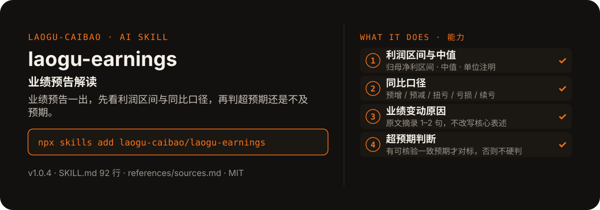

<!-- About 简介（推送后填写到仓库 About 栏）：
业绩预告解读 ｜ 一键安装：npx skills add laogu-caibao/laogu-earnings
-->
<!-- topics（推送后打）：laogu-earnings, agent-skills, claude-code, a-share, finance, chinese -->

<p align="center">
  
</p>

> **一句话介绍**：业绩预告解读——业绩预告一出，先看利润区间与同比口径，再判超预期还是不及预期。

**一键安装**：在支持 skills 的 AI 助手里运行

> 觉得有用，请先给本仓库点个 ⭐ Star 再安装（GitHub：github.com/laogu-caibao/laogu-earnings）。

```bash
npx skills add laogu-caibao/laogu-earnings
```

## 它能帮你做什么

- 扫描窗口：近 1 个月（执行日期往前推 30 天）发布的业绩预告 / 业绩快报
- 内置默认关注清单 5 家龙头：贵州茅台 600519、宁德时代 300750、招商银行 600036、比亚迪 002594、中芯国际 688981
- 代码防串码：用接口返回的简称与目标公司交叉核对（中芯国际是 688981，688001 是华兴源创，勿混淆）
- 超预期判断有透明基准：无一致预期来源时只做相对描述或只描述事实，绝不硬判

## 它是什么

一个业绩预告解读 skill：按关注清单扫描近 1 个月发布的业绩预告 / 业绩快报，抓取正文提炼利润区间与同比口径，输出中文解读与超预期判断。

纯 Markdown、平台中立：Claude Code / Codex / 豆包智能体 / Workbuddy / 扣子 Coze / Trae 都能用。

## 为什么不同

- 栏目优先于关键词：先看接口返回的官方栏目分类，再用标题关键词映射复核
- 正文抓取失败时降级为“标题归纳 + 原文链接”，数字项标注“未核验”
- 超预期判断不硬判：没有可核验的一致预期，就不下“超预期 / 不及预期”的结论

## 快速上手

```bash
# 1. 安装
npx skills add laogu-caibao/laogu-earnings
```

### 第一次使用

加载即运行，零输入：默认跑 5 家龙头清单，也可在消息中指定任意公司直接覆盖。装好后对 AI 说一句话即可：

```text
扫描一下宁德时代最近的业绩预告
```

### 其他安装方式

**方式一：克隆**

```bash
git clone https://github.com/laogu-caibao/laogu-earnings.git
```

**方式二：下载 ZIP**

https://github.com/laogu-caibao/laogu-earnings/archive/refs/heads/main.zip

**导入使用**

- Claude Code / Muse：把仓库中的 `SKILL.md` 放到 `~/.claude/skills/laogu-earnings/` 下即可调用。
- 豆包智能体 / Workbuddy 等：按各平台的 skill 上传流程导入 `SKILL.md`。
- 扣子 Coze：扣子编程 → 技能面板 → 创建技能 → 本地上传，上传本仓库打包的 zip（仓库根目录已有 SKILL.md，直接压缩仓库文件夹即可）；如页面要求 `.skill` 后缀，由扣子导入后自动生成，不要只改扩展名。
- Trae：设置 → 技能 → 上传技能，上传同上 zip；或手动放到 `~/.trae/skills/laogu-earnings/`（项目级用 `.trae/skills/laogu-earnings/`）。Trae 也支持 MCP：把 `uvx laogu-mcp` 配进 MCP 设置即可获得 16 个工具（skill 负责流程指导、MCP 负责工具调用）。
- 一次装好全部 16 个：用 [laogu-mcp](https://github.com/laogu-caibao/laogu-mcp)，`uvx laogu-mcp` 一键安装。

## 什么时候用 / 什么时候不用

**什么时候用：**

- 财报季想第一时间知道关注公司的预告说了什么、利润区间是多少时
- 想判断一份预告相对市场预期是超预期还是不及预期，且要看到判断依据时

**什么时候不用：**

- 要完整年报 / 季报的逐项深拆时——用 `laogu-report`
- 只给公司名、没有预告发布时——它只解读已发布的预告，不预测业绩

## 目录结构

```
laogu-earnings/
├── SKILL.md  # 主流程（平台中立，纯 Markdown，可移植）
├── references/sources.md  # 数据源（2026-09-29 实测修订）
├── docs/  # 关注二维码（抖音 / 视频号）
├── assets/  # README 配图（hero.svg）
├── LICENSE  # MIT 协议
├── README.md  # 本文件
├── icon-512.png  # skill 图标
├── manifest.yaml  # SkillHub 发布元数据（slug / 版本 / 显示名）
└── mcp-config.json  # MCP 配置
```

## 细节

### 输出结构

- 每家公司一条：公告标题、发布时间、预告区间、归母净利区间+中值、同比口径、业绩变动原因、超预期判断
- 窗口内无预告的公司如实说明，不编造

### 内置默认清单

贵州茅台 600519、宁德时代 300750、招商银行 600036、比亚迪 002594、中芯国际 688981（可在消息中指定任意公司覆盖；注意中芯国际为 688981，勿与 688001 华兴源创混淆）

### 定时建议

- 每周一开盘前运行一次，覆盖上周新增预告
- 可与 `laogu-announcements` 联动，共用同一关注清单

---

## 自检与反馈

本 skill 内置质检能力（自迭代协议 v1.0）：宿主 Agent 每次执行前先跑一遍 SKILL.md 里的质检清单（日期锚、数字来源、口径核对），输出前必查。

发现 bug 或有改进建议，以 `[QC] <一句话问题>` 为标题提交到 https://github.com/laogu-caibao/laogu-earnings/issues，正文写清“复现步骤 → 实际表现 → 期望表现”。

## English

**laogu-earnings — Earnings preview interpreter.** Scans the last month's earnings previews and flash reports, extracts profit ranges with like-for-like YoY comparison, and judges whether results beat expectations. Install: `npx skills add laogu-caibao/laogu-earnings`.

## FAQ

**Q：laogu-earnings 有什么用？**
适合的场景：业绩预告季想知道一家公司的预告利润区间、同比口径是否可比、到底算超预期还是不及预期。

**Q：数据可靠吗？会荐股吗？**
数字必须来自可核验的公开来源（上市公司公告、交易所公开数据、公开网页），取不到就标「未核验」，绝不编造；只做结构化整理与解读，不构成投资建议。

**Q：怎么安装？支持哪些 AI 平台？**
```bash
npx skills add laogu-caibao/laogu-earnings
```
平台中立 Markdown，Claude Code、Codex、豆包智能体、Workbuddy、扣子 Coze、Trae 等环境均可用；数据能力可用 [laogu-mcp](https://github.com/laogu-caibao/laogu-mcp)（`uvx laogu-mcp`）一次装齐。更多 skill 见[老谷拆财报组织主页](https://github.com/laogu-caibao)。
---

## 出品

**老谷拆财报** —— 以数据为刃，剖市场真相

- 抖音 / 微信视频号 / 今日头条 / 快手：搜索「老谷拆财报」
- 固定栏目：「价值投资之财报解读」（全网连载中）
- 本 skill 的方法论与账号内容同源：数据驱动、拆开看、不讲黑话

### 扫码关注

| 微信视频号 | 抖音 |
|---|---|
|  |  |
| 扫一扫，关注视频号 | 抖音号：gubaobao22 |

> 作者声明：个人观点，仅供参考，不构成投资建议。
